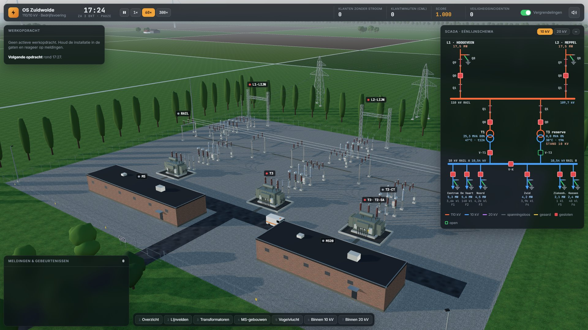
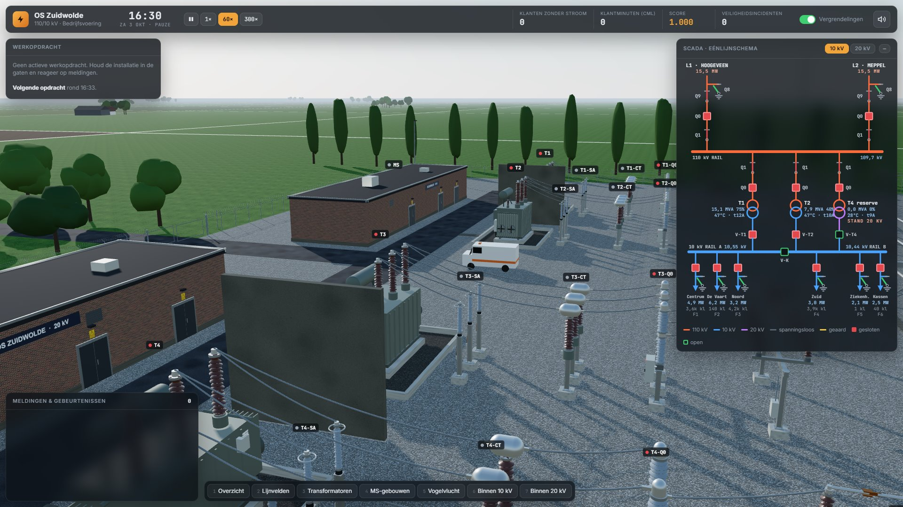
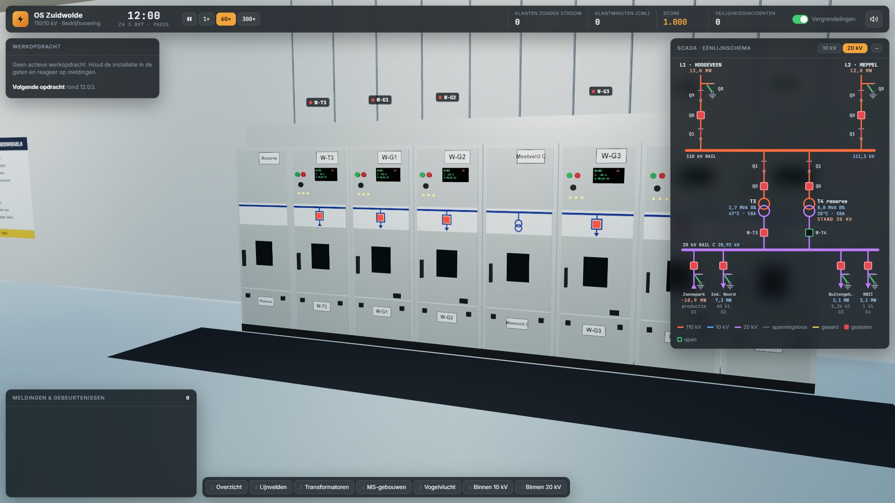
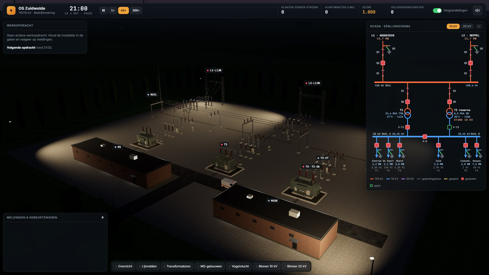
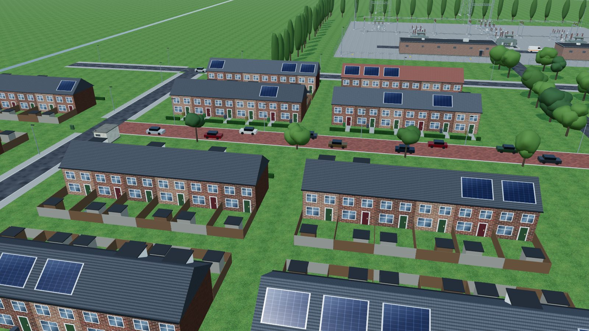
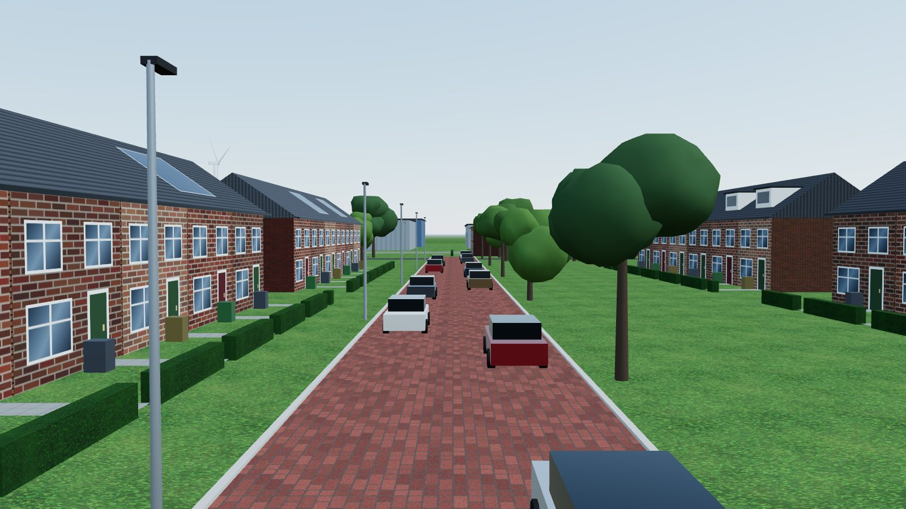
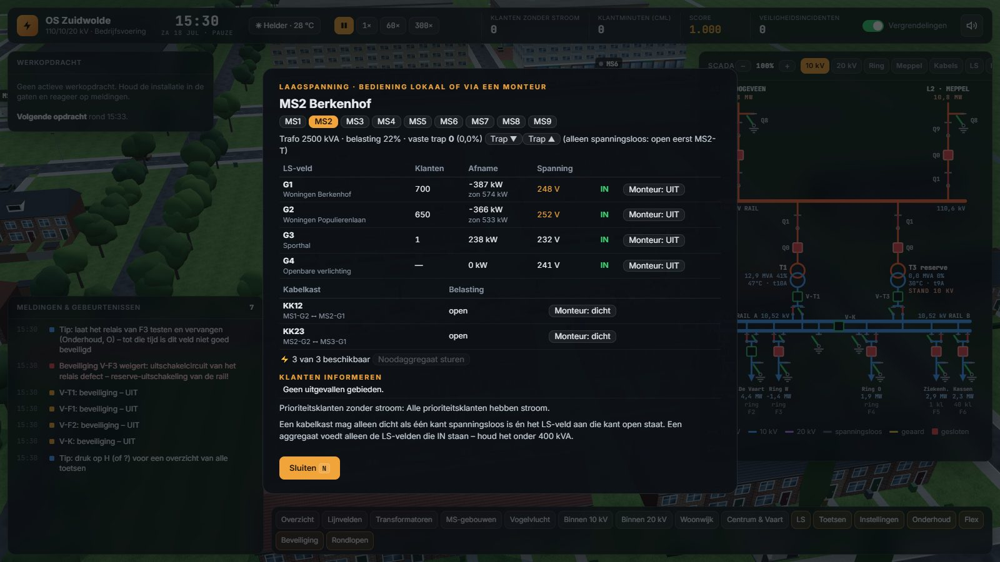
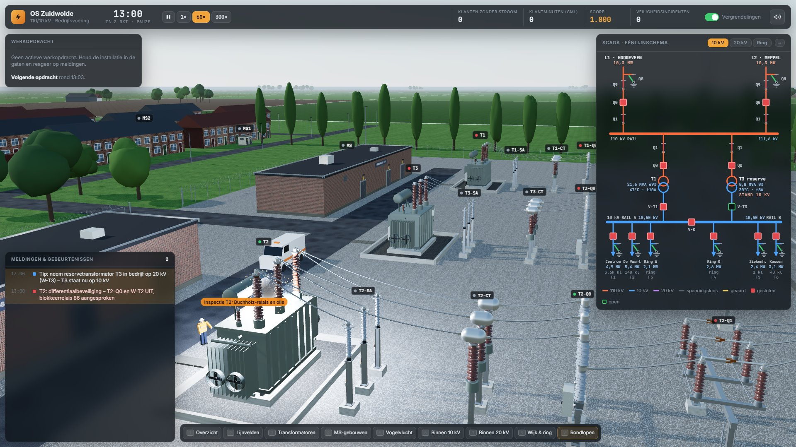

<div align="center">

# ⚡ Onderstation Simulator · OS Zuidwolde

**Realistische 3D-simulator van een 110/10/20 kV-onderstation, gewoon in je browser.**<br>
Schakel als bedrijfsvoerder in SCADA, los storingen op, stuur monteurs aan en houd het licht aan in de wijk.

[](https://github.com/ProAdmin007/Onderstation-SIM-Pro/actions/workflows/test.yml)


[](LICENSE)



[🚀 Snel starten](#snel-starten) · [✨ Functies](#functies) · [📸 Screenshots](#screenshots) · [🎮 Spelmodi](#spelmodi) · [⌨️ Bediening](#bediening) · [🏭 Het net](#het-net) · [🧑‍💻 Ontwikkelen](#ontwikkelen) · [📄 Licentie](#licentie) · [🇬🇧 English](#english)

</div>

---

**Onderstation Simulator** is een gratis, realistische **schakelsimulator voor het elektriciteitsnet**. Je bent bedrijfsvoerder van OS Zuidwolde, een onderstation met 110 kV-lijnen, drie transformatoren, een 10 kV-dubbelrailsysteem, een 20 kV-installatie en twee 10 kV-ringen met MS-stations in de wijk erachter. Alles is in 3D te zien en te bedienen, via een **SCADA-eénlijnschema** of door zelf rond te lopen.

Bedoeld voor **bedrijfsvoerders en monteurs in opleiding**, studenten **elektrotechniek** en iedereen die wil weten hoe een **netbeheerder** het licht aan houdt: van vrijschakelen en aarden tot kabelfouten, terugvoeden, netcongestie, laagspanning en relaistesten.

<a id="snel-starten"></a>
## 🚀 Snel starten

1. Download de repo (**Code → Download ZIP**) of kloon hem: `git clone https://github.com/ProAdmin007/Onderstation-SIM-Pro.git`
2. Dubbelklik op **`index.html`**. Klaar: geen installatie, geen server.
3. Kies in het menu een **les**, een **scenario**, een **dienst** of **vrij spelen**. Druk op **`H`** voor alle toetsen.

> **Updates:** bovenaan het hoofdmenu staat een updateknop. Het spel controleert bij het openen (en als je op de knop klikt) of er op GitHub een nieuwere versie staat. Zo ja, dan knippert de knop oranje. Klik erop en kies *Nieuwe versie installeren*: het spel haalt de nieuwe `index.html` van GitHub. In Chrome en Edge schrijft het spel de nieuwe versie direct over je `index.html` heen en herstart meteen. De eerste keer wijs je één keer de `index.html` van het spel aan; het spel onthoudt dat bestand (en controleert dat het echt de simulator is). Daarna gaat een update met één klik; de browser vraagt hooguit om toestemming om het bestand te wijzigen (kies *Altijd toestaan*, dan hoeft ook dat niet meer). In andere browsers wordt `index.html` gedownload; zet die over de oude heen en open hem. Je opgeslagen spellen blijven bewaard.

> Internet is nodig voor Three.js en de lettertypen (via CDN). Werkt in Chrome, Edge en Firefox. Op een trage laptop: **Instellingen (`I`) → Prestaties → Laag**.

<a id="functies"></a>
## ✨ Functies in het kort

| | |
|---|---|
| 🔌 **Echt schakelen** | 110/10/20 kV met lijnvelden, transformatoren, dubbelrail, railkoppelingen, aardschakelaars en **vergrendelingen**, synchrocheck, AVR en trappenschakelaars. |
| ⚡ **Storingen** | Blikseminslag met AR, kabelfouten met kortsluitverklikkers, **aardfouten** (U0, zoeken door te schakelen), trafotrips (relais 86), railfouten, weigerende schakelaars (50BF), **koperdiefstal** en een **brandende distributietrafo** in een MS-station, en grote incidenten zoals brand, kraan of black-out. |
| 🏘️ **10 kV-ringen** | Negen MS-stations met normaal-open punten, terugvoeden, **kabeltemperatuur** per sectie en een koppelkabel naar **OS Meppel** van een andere netbeheerder. |
| 🏠 **Laagspanning** | LS-velden per straat, **kabelkasten** tussen stations, **zonnepanelen** met overspanning, vaste trappen, **noodaggregaten**, alles lokaal of via een monteur. |
| 👷 **Werkopdrachten** | Onderhoud met optionele **schakelbrief**, werk staken, monteurs met **portofoon**, revisies, **relaistest met testkoffer** en thermografie. |
| 📞 **Klanten** | Telefoon met klantmeldingen, storingsbandje, **verwachte hersteltijd** doorgeven en prioriteitsklanten bellen. |
| 📈 **Netbeheer** | **Netcongestie** en flexibel vermogen, belastingprognose, veroudering en preventief onderhoud, beveiligingsinstellingen. |
| 🗺️ **Kabels en GIS** | Alle kabels fysiek langs de straten met moffen en aanlegjaar: **röntgenblik** in 3D, een **kabeltablet** met kaart of luchtfoto, foutplaats bepalen met de meetwagen en **graafwerk (KLIC)**. |
| 🎓 **Leren en spelen** | 11 lessen, 17 scenario's, dag- en avonddiensten, vrij spelen met incidenten, score met cijfer, **tijdlijn en herhaling**, opslaan en verder spelen. |
| 🌦️ **Sfeer** | Dag en nacht, vier seizoenen, weer (onweer, sneeuw, mist, hittegolf), ziekenhuis, kassen en kleine afnemers die zichtbaar zonder stroom zitten, **stadsleven** (trein, bus, weekmarkt, voetgangers), buren op straat bij uitval. |

<a id="screenshots"></a>
## 📸 Screenshots

| Transformatorvelden T1–T3 | 20 kV-schakelinstallatie binnen | 's Nachts met terreinverlichting |
|---|---|---|
|  |  |  |

| Woonwijk met zonnepanelen | Woonerf met MS-station | LS-venster: spanning per straat |
|---|---|---|
|  |  |  |



<a id="spelmodi"></a>
## 🎮 Spelmodi en score

- **Vrije dienst:** eindeloos spelen. Storingen komen hier vaker dan in een dienst, en af en toe slaat er een **groot incident** uit de scenario's toe.
  - De eerste komt na 1–2 uur, daarna één per paar uur. Welke het wordt is willekeurig, maar het moet passen bij het moment:
    - kabelstoring ziekenhuis met trip T1;
    - onweersbuien (zeldzaam);
    - twee kabelfouten in de woonwijk;
    - kapotte ventilatoren van T1 (zomermiddag);
    - aanrijding van een MS-station;
    - cyberaanval op SCADA;
    - wateroverlast bij MS9 (bij regen);
    - recordopbrengst van het zonnepark (heldere lente- of zomerochtend);
    - kraan raakt een 110 kV-lijn;
    - brand in het 10 kV-gebouw;
    - concert op het Marktplein (lente- of zomeravond);
    - laadpiek in de woonwijk (herfst- of winteravond);
    - landelijke black-out.
  - Linksboven zie je welk incident er loopt en hoe lang nog. Elk incident ruimt zichzelf op: reparaties, blussen, SCADA weer terug.
  - Heeft na afloop iedereen weer stroom, dan krijg je +100.
- **Dagdienst** (07–15 u) en **Avonddienst** (15–23 u): een dienst van 8 uur met een dienstrapport, een cijfer (A+ t/m E), sterren, badges en een highscore.
- **Leerscenario's** met uitleg, stap voor stap. De schakelaar die je moet bedienen knippert groen en de les gaat vanzelf verder als je het goed doet:
  1. *Bediening en SCADA*: selecteren, een veld uit- en inschakelen, klantminuten.
  2. *Vrijschakelen en aarden*: de vijf veiligheidsregels op de kabel van F6.
  3. *Kabelfout in de ring*: verklikkers lezen, isoleren en terugvoeden via het normaal-open punt.
  4. *Reservetransformator T3*: T2 valt uit; T3 omschakelen naar 20 kV en beide railhelften voeden.
  5. *Spanningsregeling*: de trappenschakelaar met de hand bedienen en de AVR het laten overnemen.
  6. *Relaistest met de testkoffer*: veld F6 vrijmaken, de proeven uitvoeren en een te traag relais afkeuren.
  7. *OS Meppel en de koppelkabel*: MS4 en MS5 terugvoeden vanuit Meppel, flex inzetten om binnen 4 MW te blijven, en bij het terugschakelen eerst openen en dan sluiten (nooit parallel met Netbeheer Noord).
  8. *Kabeltemperatuur en congestie*: een winteravond met een verkeerd geschakelde ring. Lees het tabblad Kabels, zet flex in als eerste hulp en normaliseer de ring.
  9. *Aardfout zoeken*: U0 en de aanwijzingen lezen, T3 inzetten voor rail B, de rails splitsen en de verdachte kabel vrijschakelen tot U0 verdwijnt.
  10. *Selectiviteit en storingsschrijver*: de tijd-stroomgrafiek, een te snelle reserve die bij een kabelfout de hele 10 kV laat uitvallen, en de registratie lezen.
  11. *Laagspanning: kabelkast en vaste trap*: een straat via een kabelkast voeden, de distributietrafo spanningsloos maken en de vaste trap laten verlagen.
- **Scenario's:**
  - *Kabelstoring ziekenhuis*: T1 valt uit en het ziekenhuis draait op noodstroom.
  - *Storm boven Drenthe*: regen, onweer, blikseminslagen en een defect AR-relais.
  - *Avondpiek op één poot*: T1 staat in onderhoud en reservetransformator T3 draagt de 10 kV; schakel de kassen af om T3 heel te houden.
  - *Black-out*: bouw het station weer op.
  - *Hittegolf* (zomer, ±36 °C): de ventilatoren van T1 vallen uit en een kabel in het centrum bezwijkt door de hitte.
  - *Winteravond met sneeuw*: hoge belasting, een ringfout met terugvoeden zonder kabels te overbelasten, en daarna een lijnstoring.
  - *Dubbele kabelfout in de woonwijk*: twee fouten tegelijk; een eiland tussen de fouten komt pas na de eerste reparatie terug.
  - *Aanrijding MS-station*: een vrachtwagen ramt MS5. De RMU is onbedienbaar; isoleer vanaf MS4 en voed terug via het normaal-open punt. Later volgt een noodaggregaat.
  - *Cyberaanval op SCADA*: bediening op afstand valt weg. Loop het station in (`V`) en schakel lokaal aan het veld, terwijl de kassen en lijn L1 uitvallen.
  - *Overstroming De Vaart*: het water stijgt bij MS9. Sluit het normaal-open punt, haal MS9 uit de ring (MS8-R open, V-F2 uit) vóór het water er is, en neem MS9 na het droogvallen weer in bedrijf.
  - *Kraan raakt de 110 kV-lijn*: L1 is urenlang weg en TenneT laat via L2 maar 33 MW toe tijdens de avondpiek; blijf eronder met flexibel vermogen.
  - *Brand in het 10 kV-gebouw*: de brandbel gaat, er slaan vlammen uit het dak en er komt rook. Twee brandweerwagens rijden met sirene en zwaailichten naar de poort en vier brandweerlieden gaan op verkenning. De brandweer wil de hele 10 kV spanningsloos voordat ze naar binnen gaat; het ziekenhuis draait op noodstroom. Is de 10 kV spanningsloos, dan steekt de ladderwagen de ladder op en blust met een waterstraal; de vlammen worden kleiner en de rook wordt stoom. Daarna stap voor stap herstellen (V-F6 heeft rookschade).
  - *Concert op het Marktplein*: podium, lichtshow en foodtrucks overbelasten MS6; het podium heeft een flexcontract.
  - *Laadpiek op een winteravond*: een uitgebreid laadplein en thuisladers in de hele woonwijk; congestie in trafo's en kabels.
  - *Zonnige pinksterzondag*: weinig afname en ±50% meer zonnepanelen: overspanning in de lange straten. Verlaag de vaste trappen. Dat kan alleen spanningsloos, dus open de trafo pas als de monteur er bijna is, of voed de straat via een kabelkast. Doelen: om 14:00 alle straten binnen 207–253 V, hooguit 30 keer omvormers uit, minder dan 10.000 klantminuten.
  - *Aardfout tijdens onweer*: blikseminslagen op beide lijnen, een aardfout in de woonwijkring en later een kabelfout. Vind de aardfout binnen 30 minuten, voordat er een dubbele aardfout ontstaat.
  - *Zonnepiek*: een uitgebreid zonnepark (60 MWp) levert op een lentedag meer terug dan T2 aankan. Zet T3 op 20 kV parallel om T2 heel te houden zonder het zonnepark af te schakelen.
- **Dienstrapport als PDF:** met de knop *📄 PDF* in het rapport download je een PDF met het cijfer, de doelen, de statistieken, de tijdlijn, de leermomenten en de badges, bijvoorbeeld voor een opleidingsdossier. De PDF-bibliotheek (jsPDF) wordt pas bij het klikken via de CDN geladen.
- **Rapport met tijdlijn en herhaling:** na afloop zie je een tijdlijn met klanten zonder stroom, je score, storingen (rood), je handelingen en behaalde doelen.
  - *Leermomenten* noemen de langste onderbrekingen (met je reactietijd) en waar je punten liet liggen, met een tip per fout.
  - Met *▶ Herhaling*, of door op de tijdlijn of een leermoment te klikken, speel je de dienst opnieuw af. SCADA, de 3D-installatie en de tellers tonen dan de toestand van dat moment; met de schuifbalk spoel je door.
- **Moeilijkheid:** Rustig, Normaal of Zwaar. Dit bepaalt hoe vaak storingen optreden en hoe vaak een fout blijvend is.
- **Score:** je begint met 1.000 punten.
  - **Cijfer:** geijkt op de scoreverdeling van goed gespeelde diensten en scenario's.

    | Cijfer | Dienst (8 uur) | Scenario |
    |---|---|---|
    | A+ | ≥ 3.300 | ≥ 1.600 |
    | A | ≥ 2.700 | ≥ 1.450 |
    | B | ≥ 2.100 | ≥ 1.300 |
    | C | ≥ 1.500 | ≥ 1.100 |
    | D | ≥ 900 | ≥ 850 |

    In de vrije dienst wordt de score omgerekend naar 8 uur. Een les afronden zonder veiligheidsincident is A+.
  - Erbij: snel herstel van een onverwachte onderbreking (+20 of +40), een behaald doel (+100), een voltooide werkopdracht (+150) en een dienst zonder incidenten (+200).
  - Eraf: klantminuten, het ziekenhuis zonder net, veiligheidsincidenten (−150), een gemist doel (−150), thermische trips (−100), inschakelen op een fout (−40), overbelasting (−30), spanningsafwijkingen en circulatiestroom (−20).
- Tijdens een pauze kun je niet schakelen.

<a id="bediening"></a>
## ⌨️ Bediening

| Toets | Functie | Toets | Functie |
|---|---|---|---|
| `H` / `?` | toetsenoverzicht | `V` | rondlopen (`WASD`, `F` schakelt) |
| `1`–`9` | camerastandpunten | `Z` | zaklamp |
| `Spatie` / `P` | pauze | `Esc` | sluiten / pauzemenu |
| `B` | beveiliging | `C` | flex en congestie |
| `O` | onderhoud | `K` | testkoffer |
| `N` | laagspanning | `I` | instellingen |
| `R` | storingsschrijver | `T` | weer en tijd (echt weer, doorspoelen) |
| `WASD` / pijltjes | beeld schuiven | dubbelklik | daarheen vliegen |
| `X` | röntgenblik: kabels in 3D | `G` | kabeltablet (GIS-kaart) |
| `U` | begeleiding | | |
| `Ctrl+S` | opslaan | `L` / `M` | labels / geluid |

<details>
<summary><b>Alle details over bediening, instellingen en opslaan</b></summary>

- Druk op `H` (of `?`, of de knop *Toetsen*) voor een **overzicht van alle toetsen**.
- Klik op een schakelaar in 3D of in het SCADA-schema en kies vervolgens IN/UIT of SLUITEN/OPENEN.
- **Muis in het overzicht** (werkt als een 3D-kaart): links slepen schuift over de grond, rechts slepen (of `Shift` + links) draait en kantelt, scrollen zoomt naar het punt onder de muis en dubbelklik vliegt naar dat punt. `WASD` of de pijltjestoetsen schuiven ook, sneller naarmate je verder weg bent. Het beeld blijft binnen de wereld en de camera gaat nooit onder de grond. Liever de oude bediening (links draaien, rechts schuiven)? Kies *Instellingen* (`I`) → *Muis* → *Klassiek*.
- `1`–`9` camerastandpunten (6 = binnen 10 kV, 7 = binnen 20 kV, 8 = woonwijk, 9 = centrum en De Vaart); *Ziekenhuis*, *Kassen* en *RWZI* staan als knoppen in de balk onderaan
- `X` zet de **röntgenblik** aan of uit, `G` opent de **kabeltablet**
- `K` opent de **testkoffer** tijdens een relaistest
- `T` opent **weer en tijd** (of klik op het weer in de bovenbalk)
- `R` opent de **storingsschrijver**
- `N` opent het **LS-venster**: LS-velden, kabelkasten, noodaggregaten en klanten informeren
- **Rondlopen (first person):** druk op `V` of op de knop *Rondlopen*.
  - Je loopt met `WASD`, rent met `Shift` en kijkt rond met de muis.
  - Richt het kruis op een schakelaar: `F` schakelt direct. `E` maakt de cursor vrij (en opent het paneel als je naar een schakelaar kijkt), zodat je ook in het SCADA-schema kunt schakelen. Met nog een keer `E` loop je verder.
  - Je loopt niet door apparatuur, muren, huizen of het hek. De gebouwen kun je via de deuren in, en via de open poort loop je de wijk in naar de MS-stations.
  - Met `V` stop je met rondlopen; met nog een keer `V` ga je verder waar je was.
  - Lopen gaat met 2,2 m/s, rennen met `Shift` met 8 m/s en sprinten met `Q` met 16 m/s. Met `spatie` spring je; pauzeren gaat tijdens het rondlopen met `P`.
  - Met `Z` zet je je **zaklamp** aan of uit. Handig 's nachts op het terrein, in een donker MS-station of bij een storing in het gebouw.
- **Instellingen (`I`, de knop *Instellingen* of het pauzemenu):**
  - **Prestaties:** voorinstelling Laag / Midden / Hoog, of zelf: resolutie (40–100%), schaduwen (uit/laag/hoog), maximaal 30, 60 of onbeperkt beelden per seconde, omgevingslicht dat de zon volgt, verkeer en buren, regen en sneeuw, en een beeldenteller. Op een trage computer of laptop: kies *Laag*.
  - **Automatische resolutie** (standaard aan): haalt de computer de beeldfrequentie niet, dan gaat de resolutie vanzelf in stapjes omlaag (tot 60%) en bij ruimte weer omhoog. Met de beeldmeter aan zie je het percentage naast de fps.
  - Onder de motorkap: de statische wereld is per zone samengevoegd (station, woonwijk, centrum, grote afnemers), zodat de grafische kaart alleen tekent wat in beeld is. De schaduwkaart wordt alleen opnieuw berekend als er op het stationsterrein iets beweegt (schakelaars, monteurs, brandweer), en de schermen in het gebouw alleen als je in de buurt bent. Het paneelwerk is verdeeld over opeenvolgende beelden, zodat er geen periodieke hapering is.
  - **Weer en tijd** (toets `T`, de knop *Weer & tijd*, een klik op het weer in de bovenbalk, of in de instellingen). De simulatie loopt gewoon door:
    - **Weer:** kies het échte weer (helder, bewolkt, regen, onweer, sneeuw, mist of hittegolf; het verandert geleidelijk) of laat het met *🔄 Automatisch* vanzelf wisselen. In lessen en scenario's hoort het weer bij de opdracht en ligt het vast.
    - **⏭ Bui laten overtrekken:** regen, onweer of sneeuw is direct voorbij. Deze knop staat ook naast het weer in de bovenbalk zolang het nat is.
    - **Doorspoelen** (+15 min, +1 uur, +3 uur): de simulatie loopt in kleine stappen snel vooruit. Alles gebeurt gewoon, ook storingen, en bij een nieuwe storing stopt het doorspoelen vanzelf. Niet tijdens een les; in een dienst niet voorbij het einde.
    - **👁 Alleen bekijken:** schuif de klok over het hele etmaal, laat de tijd versneld lopen (▶) en kies weer en seizoen, om te zien hoe de wereld eruitziet. De simulatie staat dan stil en SCADA blijft de echte situatie tonen; met *Terug naar de dienst* staan klok, weer en seizoen weer zoals ze waren.
  - **Weer en seizoen:** zet het weer zelf op helder, bewolkt, regen, onweer, sneeuw, mist of hittegolf (geleidelijk; dubbelklik = direct), of laat het automatisch wisselen. Ook het seizoen kun je tijdens het spelen veranderen.
  - **Geluid:** hoofdvolume plus vier kanalen: omgeving (brom, verkeer, vogels, regen), schakelen (vermogenschakelaars, motoren, vlambogen), meldingen en alarmen, en telefoon.
  - Alles wordt in de browser bewaard.
- **Opslaan en verder spelen** (vrije dienst, dag- en avonddienst):
  - Er zijn **vier opslagplekken**: *Automatisch* (elke 2 minuten en bij het sluiten van de pagina) en **opslagplek 1–3**. Met *💾 Spel opslaan* in het pauzemenu kies je de plek; `Ctrl+S` slaat snel op in de plek waaruit je hervatte of waar je het laatst handmatig opsloeg. *Opslaan en naar hoofdmenu* bewaart je spel in *Automatisch*.
  - In het hoofdmenu staan onder *Verder spelen* alle opgeslagen spellen, met de dienst, de tijd, het seizoen, de score en wanneer je opsloeg. Elk kun je apart verwijderen.
  - Bewaard worden: de stand van alle schakelaars, storingen, slijtage, temperaturen, de lopende werkopdracht (met je schakelbrief), weer, flex, beveiligingsinstellingen, score, statistieken en de tijdlijn, en van de kabels de moffen, het graafwerk en een bekende foutplek.
  - Reparaties en andere geplande gebeurtenissen worden bij het hervatten opnieuw ingepland. Een groot incident dat liep, wordt netjes afgerond.
  - Speel je een dienst tot het einde, dan verdwijnt het automatisch opgeslagen spel. Je eigen opslagplekken blijven bewaard.
- **Pauzemenu (`Esc`):** hervatten, de dienst beëindigen met rapport, of de score opslaan en terug naar het hoofdmenu.
- **Begeleiding** (toets `U` of de knop *Begeleiding*; in vrij spelen, diensten en scenario's): een paneel dat bij elke situatie uitlegt **wat er gebeurt**, **waarom** en **wat je moet doen**, met stappen die zichzelf afvinken zodra je ze hebt uitgevoerd en een knop om het juiste veld in SCADA te tonen. Het behandelt railfouten, spanningsloze rails, lijnen, trafo-uitval en -oververhitting, aardfouten, kabelfouten in velden en ringen, MS-stations (brand, koperdiefstal, beschadiging, zekeringen), aggregaten, over- en onderspanning, LS-storingen (die je niet in SCADA ziet), warme kabels, graafwerk, OS Meppel en grote incidenten. Is er niets aan de hand, dan geeft het tips. Het venster kun je verslepen aan de titelbalk en groter of kleiner maken met de hoek rechtsonder (met een scrollbalk als niet alles past); positie en grootte worden onthouden, en dubbelklikken op de titelbalk zet ze terug. Bij de eerste keer opstarten staat de begeleiding vanzelf aan; zet je hem uit, dan onthoudt het spel dat. De knop knippert als er een kritieke storing is terwijl de begeleiding dicht staat. Het kost geen punten en verandert niets aan het spel.
- **Railfout in SCADA:** een rail met kortsluiting is rood gestippeld en knippert, met bovenin het tabblad *⚡ RAILFOUT rail …*.
- **Lopende storingen** (paneel boven *Meldingen & gebeurtenissen*): wat er **nu** speelt, opgebouwd uit de toestand van de installatie en niet uit het logboek. Per storing zie je sinds wanneer en hoe lang al, de status (bijvoorbeeld *fout zoeken*, *weggeschakeld – wacht op reparatie*, *reset mogelijk*) en hoeveel klanten zonder stroom zitten.
  - Kritieke storingen staan bovenaan en knipperen rood.
  - Een groot incident staat al in de balk boven de taken; het paneel toont alleen wat er in de installatie speelt, plus aangekondigd graafwerk (KLIC) waarvoor de kabels nog niet zijn aangewezen.
  - Gevolgen staan bij de oorzaak: MS-stations die door een kabelfout in hun ring zonder stroom zitten, worden bij die kabelfout genoemd.
  - Klik op een storing om er in SCADA naartoe te gaan. Is hij opgelost, dan verdwijnt hij vanzelf. Zonder storingen staat er *✓ Geen lopende storingen*.
- **Klaar om te schakelen:** als de storingsdienst of TenneT klaar is, of een transformator weer gereset mag worden, hoor je een oplopend klokgeluid en verschijnt een groene banner. Het betreffende veld knippert groen in SCADA en in 3D tot je het schakelt.
</details>

<a id="het-net"></a>
## 🏭 Het net in de simulator

<details>
<summary><b>Installatie: 110 kV, transformatoren, 10/20 kV, ringen en OS Meppel</b></summary>

- **110 kV:** twee lijnvelden (L1 Hoogeveen, L2 Meppel), een railsysteem en drie transformatorvelden.
- **T1** (110/10,5 kV, 31,5/40 MVA) voedt de 10 kV-installatie. Dat is een **dubbelrailsysteem**: rail A en rail B, normaal gekoppeld via V-K, met de velden F1–F6.
  - Elk veld (ook V-T1 en V-T3) heeft twee **railkeuzescheiders**: QA naar rail A en QB naar rail B. Normaal staan F1–F3 en T1 op rail A, en F4–F6 en T3 op rail B.
  - **Omzetten onder last** mag alleen als V-K gesloten is: eerst de scheider naar de nieuwe rail sluiten, dan de oude openen. Zonder koppeling blokkeert de vergrendeling (of, met de vergrendelingen uit, ontstaat er een vlamboog). V-K kan niet open zolang een veld op beide rails staat.
  - Railaardschakelaars RA-Q8 en RB-Q8 zitten in de meetvelden.
- **T2** (110/21 kV, 20/25 MVA) voedt de 20 kV-installatie in het tweede gebouw. Die heeft twee railhelften:
  - **rail C1** met W-T2, G1 Zonnepark (productie en teruglevering; een overstroomfout kan alleen overdag, als er stroom loopt) en G2 Industrieterrein Noord;
  - **rail C2** met W-T3, G3 Buitengebied Oost en G4 Waterzuivering;
  - de **railkoppeling W-K** (normaal gesloten, met synchrocheck tot 0,5 kV verschil) en per railhelft een **railaardschakelaar** (RC-Q8, RD-Q8) in het meetveld.
- **T3** is de omschakelbare reservetransformator (110/10,5-21 kV, 20/25 MVA).
  - Hij staat als warme reserve op 10 kV.
  - Via **V-T3** voedt hij 10 kV-rail B, via **W-T3** 20 kV-rail C2 (en via W-K ook C1).
  - Omschakelen kan alleen spanningsloos (T3-Q0, V-T3 en W-T3 UIT).
  - Inschakelen op de verkeerde spanning blokkeert de vergrendeling. Met de vergrendelingen uit leidt het tot een incident en wikkelingsschade.
  - Let op: T3 is kleiner dan T1. Neemt hij tijdens de avondpiek de hele 10 kV over, dan raakt hij overbelast.
- **OS Meppel** (aan de andere kant van L2): het 110 kV-deel en de transformator zijn van een andere netbeheerder (*Netbeheer Noord*), grijs in SCADA en niet bedienbaar. Alleen de **uitgaande velden zijn van jou**:
  - **MP1** Meppel-Oost (woningen);
  - **MP2** Bedrijventerrein Blankenstein;
  - **MP3** de **koppelkabel** naar MS5 Bedrijvenpark Zuid in je woonwijkring.
  De koppeling **MS5-K** is normaal open. Sluiten mag alleen als de ringkant spanningsloos is: dan voedt Meppel MS5 (en verder) terug. Parallel schakelen met Netbeheer Noord is niet toegestaan. De vergrendeling houdt dat tegen, en ontstaat het toch, dan schakelt Netbeheer Noord de koppeling af. Over de koppeling mag maximaal ±4 MW. Af en toe heeft Netbeheer Noord zelf een storing aan de 110 kV-kant; dan vallen je velden in Meppel even weg. Alles zie je op het SCADA-tabblad *Meppel*.
- **Twee 10 kV-ringen achter het station:**
  - **Ring Woonwijk:** V-F3 (rail A) → MS1–MS5 → V-F4 (rail B), normaal-open punt **MS3-R**.
  - **Ring Centrum – De Vaart:** V-F1 → MS6 Marktplein → MS7 Stationsstraat ‖ MS8 De Vaart Noord → MS9 De Vaart Zuid → V-F2, normaal-open punt **MS7-R**. Het centrum heeft appartementen met winkels, een plein en een station; bedrijventerrein De Vaart heeft hallen, een bouwmarkt en een tankstation.
  - Elk station heeft lastscheiders naar links en rechts, een transformatorschakelaar, een 10/0,4 kV-trafo en laagspanningsvelden naar woonwijken, een school, een supermarkt, een huisartsenpost, een laadplein en bedrijven.
  - Bij een kabelfout spreken **kortsluitverklikkers** aan bij de stations tussen het voedingspunt en de fout. Isoleer de kabel achter het laatste station met een verklikker, sluit het normaal-open punt en schakel het veld weer in.
- **Stroom en spanning in de ringkabels:** per kabelsectie wordt de belastingstroom berekend (rating 330 A, kopkabels 400 A), plus de spanning per station inclusief het spanningsverlies over de kabels.
  - In SCADA zie je de stroom per veld, MW en kV per station, en kabels die oranje of rood knipperen bij hoge belasting.
  - **Kabeltemperatuur:** elke ringkabel en veldkabel warmt langzaam op naar de grondtemperatuur plus 65 °C × (belasting)². De tijdconstante is 40 min voor ringkabels en 30 min voor veldkabels. Kort overbelasten mag dus, lang niet:
    - boven 85 °C krijg je een waarschuwing;
    - boven 90 °C (het maximum voor XLPE) kost het punten;
    - vanaf 105 °C brandt de kabel door.
    Bij 130% duurt dat ongeveer een uur, bij 150% zo'n 40 minuten. De temperatuur staat in het tabblad *Kabels*, in het stationspaneel en in het veldpaneel.
- **Straatverlichting:** elk MS-station heeft een LS-veld *Openbare verlichting* met een schemerschakeling. Alle lantaarns hangen aan het dichtstbijzijnde station en gaan uit als dat station of het OVL-veld spanningsloos is, met een lichtvlek op straat als ze branden.
- **Inloop-MS-stations:** elk ringstation kun je in, via de open deur of met de knop *Naar binnen* in het stationspaneel. Binnen staan:
  - een compacte RMU met de velden L, T en R, met standmelders, spanningslampjes en een kortsluitverklikker (KSV);
  - een laagspanningsrek met een hoofdschakelaar en NH-lastscheiders per LS-veld (de klep gaat echt open of dicht);
  - de distributietransformator achter een gaashek;
  - een **RTU-kast** aan de muur (RTU, I/O, LTE-router met antennes, firewall, glasvezelaansluiting en accu), met een LTE-antenne op het dak en de glasvezel uit de vloer. De LEDs knipperen en worden rood als de SCADA-verbinding wegvalt (cyberaanval).
  Schakelen gaat met het richtkruis: `F` voor direct schakelen, `E` voor het paneel.
</details>

<details>
<summary><b>Gebouwen en schakelvelden</b></summary>

Binnen staat een rij van 13 metaalomsloten schakelvelden (V-T1, F1–F3, meetveld, koppeling V-K, F4–F6, V-T3). In het 20 kV-gebouw staan W-T2, G1, G2, meetveld C1 met RC-Q8, koppeling W-K, meetveld C2 met RD-Q8, G3, G4 en W-T3. Elk veld heeft een live display, mimic-schema met standmelder en spanningslampjes. Klik op een veld om het te bedienen. Verder: beveiligingskasten, bedieningsbureau met live SCADA- en meldingenscherm, accubatterij en eigenbedrijfstransformator.

Links van het 10 kV-gebouw staat de **serverruimte** (gebouw *SCADA · Servers*, camerastandpunt *Serverruimte*): twee rijen racks met knipperende servers (SCADA A en B, historian, front-end voor de RTU-communicatie, firewall, netwerk, glasvezel-ODF, LTE-gateway en GPS-tijdserver) met een koude gang ertussen, kabelgoten met glasvezel, een UPS, koeling, gasblussing en een bedienplek met de SCADA-schermen. Buiten staan de buitendelen van de koeling, een LTE-mast en een GPS-antenne. Bij een cyberaanval kleuren de LEDs rood.
</details>

<details>
<summary><b>Belasting</b></summary>

De belasting is bewust stevig gekozen. De velden en distributietrafo's zijn gedimensioneerd op de winterpiek met 20–25% marge. In de normale schakeltoestand blijft alles onder 90%; bij terugvoeding, uitval of een extra piek wordt het snel krap. Daar zijn het tabblad *Kabels* en de flexmarkt voor.
</details>

## 🛠️ Bedrijfsvoering en hulpmiddelen

<details>
<summary><b>Schakelbrieven</b></summary>

Bij een werkopdracht zie je de stappen meteen en kun je gewoon schakelen. Wil je bonuspunten, kies dan vóór de eerste stap *Zelf een schakelbrief opstellen*. Je kiest de handelingen (er zitten afleiders tussen), zet ze in volgorde en dient de brief in bij wachtchef Marieke.
  - Goedgekeurd: +40 (+15 na correcties). Afgekeurd: −10, met uitleg waarom die stap niet klopt. Hint: −5.
  - Ben je aan een brief begonnen, dan zie je de stappen pas na goedkeuring. Wijk je daarna af van je goedgekeurde brief, dan kost dat −25. Zonder brief is er geen straf.
</details>

<details>
<summary><b>Portofoon</b></summary>

Monteurs hebben een naam en melden zich bij aankomst en als het werk klaar is. Wil je schakelen aan of vlakbij hun werk, dan opent eerst het portofoonvenster:
  - **melden**: de monteur bevestigt en daarna wordt er geschakeld (+10);
  - **zonder melden schakelen**: −50 en een boze monteur;
  - **annuleren**.
</details>

<details>
<summary><b>Monteurs</b></summary>

Collega's in een veiligheidsvest komen bij inspecties, werkopdrachten en storingen, en vertrekken weer als het werk klaar is.
  - Werk op het stationsterrein: ze lopen vanaf de poort naar het werk.
  - Werk buiten het hek (MS-stations, kabels, LS-storingen, zekeringen, aggregaten): ze rijden met een **storingsbusje** vanaf het onderstation over de wegen erheen, parkeren met knipperende zwaailamp **op de stoep** links of rechts naast het werk (niet pal voor het station of de kast, op een vrije plek, zodat auto's er nog langs kunnen) en lopen het laatste stuk. Zijn ze klaar, dan stappen ze in en rijdt het busje terug. Bij een dichte spoorwegovergang wacht het busje.
</details>

<details>
<summary><b>Dienstoverdracht</b></summary>

Bij diensten en scenario's, niet bij vrij spelen of de lessen.

Bij de start geeft de operator van de vorige dienst een overdracht.
  - Je ziet alle afwijkingen van de normale toestand, automatisch uit de installatie gehaald, plus het weer en de verwachte piek.
  - Bij dag- en avonddiensten begint het station met 2–3 willekeurige afwijkingen. Voorbeelden: AR van een lijn nog uit na een relaistest, het normaal-open punt verlegd, F5 tijdelijk op rail A, T3 nog op 20 kV, L2 in onderhoud, of de kassen uit tot een afgesproken tijd.
  - Open punten staan links bij je dienst; elk netjes afgehandeld punt geeft +25. Afspraken niet nakomen (bijvoorbeeld te vroeg inschakelen) kost −20.
</details>

<details>
<summary><b>Belastingprognose</b></summary>

Tabblad *Prognose*.

De verwachte belasting op 10 en 20 kV voor de komende 8 uur, met seizoen en het huidige weer, afgezet tegen de capaciteit van de transformatoren in bedrijf (en met T3 erbij).
  - Je ziet de piek, het moment van overbelasting en een advies (T3 bijschakelen, kassen afschakelen), plus een N-1-tip.
  - Dreigt er binnen 1,5 uur overbelasting, dan krijg je een melding.
</details>

<details>
<summary><b>Telefoon en klantmeldingen</b></summary>

Klanten bellen bij uitval. De telefoon gaat over bovenin beeld; neem op en kies je antwoord:
  - *“Dat is bekend, we werken eraan”* bij uitval die je in SCADA ziet (+5). Meestal hoef je dat niet zelf te zeggen: wie belt uit een gebied dat in SCADA spanningsloos is, krijgt automatisch het **storingsbandje**. Je telefoon gaat dan niet over. Zo heeft het oplossen van de storing voorrang. Elke ±10 minuten zie je een samenvatting (bijvoorbeeld *📼 Storingsbandje: 23 bellers uit MS2, MS3 …*), en het aantal staat in het eindrapport;
  - *“Laat uw installateur kijken”* als alleen één woning zonder stroom zit (+10);
  - *monteur sturen naar een MS-station* bij een **LS-storing**: een doorgebrande zekering in een laagspanningsveld. Die zie je **niet** in SCADA, alleen via klantmeldingen. Zoek het adres op in het ringschema (welke straat hangt aan welk station) en stuur de monteur naar het goede station (+60 bij snel herstel, −20 bij een verkeerd station). Ook vanuit het stationspaneel kun je een monteur sturen.
  - Neemt niemand op, dan hangt de klant na ±45 s op (−5). Loopt er een uitval, dan wachten bellers ±2 minuten en kost ophangen geen punten.
</details>

<details>
<summary><b>Laagspanning</b></summary>

Toets `N`, de knop *LS* of het SCADA-tabblad *LS*.

- Per MS-station zie je de **LS-velden** (straten en bedrijven): aan/uit, afname, opwek van zonnepanelen en de **spanning per straat** (norm 207–253 V).
  - LS is **niet op afstand bedienbaar**. Je schakelt lokaal (loop het station binnen met `V` en gebruik `F`) of je stuurt een **monteur** (±7–11 min reistijd, korter als er al iemand is).
  - **Kabelkasten** (KK12, KK23, KK34, KK45, KK67) koppelen een straat aan een straat van het buurstation. Valt een station uit, dan voed je zo één straat via de buurman. Dat mag alleen als één kant spanningsloos is én het LS-veld aan die kant open staat: anders voed je via de distributietrafo het MS-net terug. Parallel schakelen is niet toegestaan. Een kabelkast kan ±280 kW aan; daarboven smelt de zekering.
  - **Zonnepanelen** (±1,2 kWp per woning) verhogen op zonnige middagen de spanning in lange straten. Boven 253 V schakelen de omvormers af en bellen klanten. De oplossing is de **vaste trap** van de distributietrafo (−2 … +2, 2,5% per stand). Die mag alleen spanningsloos worden versteld: open eerst `MSx-T`, eventueel met een kabelkast of aggregaat om de klanten te voeden. Te laag zetten geeft op een winteravond onderspanning (< 207 V).
</details>

<details>
<summary><b>Punten terugverdienen bij een grote uitval</b></summary>

Klantminuten blijven tellen, maar je kunt met acties punten terugverdienen:
  - **Herstelbonus:** elke klant die na een storing weer stroom krijgt, levert punten op; sneller herstel levert meer op, en prioriteitsklanten geven extra. Wie je zelf afschakelde, telt niet mee.
  - **Noodaggregaten:** drie aggregaatsets van 2 × 1600 kVA. Stuur er een naar een spanningsloos MS-station (±15–25 min). Het storingsbusje brengt het aggregaat op een aanhanger en zet het in het gras naast het station; zolang het draait komt er rook uit de uitlaat en hoor je de dieselmotor als je in de buurt bent. De monteur opent `MSx-T` en het aggregaat voedt de LS-velden die IN staan. Eén set kan altijd alle huizen van een station voeden, ook op een koude winteravond. Met bedrijven, laadplein of school erbij kan het te veel worden: houd het onder 2 × 1600 kVA (schakel zo nodig groepen af), anders valt het uit. Is het MS-net terug, laat het dan afkoppelen: de monteur sluit `MSx-T` weer.
  - **Rotatie:** is er te weinig transformatorcapaciteit (een 110/10 kV-trafo boven 88%), dan tellen klanten die je zelf afschakelt de eerste 45 minuten maar half. Schakel je ze binnen 10–75 minuten weer in (rouleren), dan krijg je punten. Na 45 minuten krijg je een waarschuwing.
  - **Klanten informeren:** geef per uitgevallen gebied een **verwachte hersteltijd** door (+10 binnen 10 min); haal je die, dan krijg je punten, ben je later, dan kost het punten. **Bel prioriteitsklanten** (ziekenhuis, RWZI, huisartsenpost) als ze zonder stroom zitten (+20 binnen 10 min).
</details>

<details>
<summary><b>Netcongestie en flexibel vermogen</b></summary>

Toets `C` of de knop *Flex*.

- Een overzicht toont de zwaarst belaste kabels en transformatoren.
  - Zeven klanten hebben een flexcontract: het laadplein (slim laden), het transportbedrijf (e-trucks later laden), het koelhuis, de metaalbewerking, de batterij van het distributiecentrum, de kassen (belichting dimmen) en het zonnepark (terugregelen).
  - Je vraagt ze 25–100% terug te regelen. Na ±2 min is het actief; de vergoeding (€/MWh) gaat van je score af (1 punt per € 100). Dat is meestal veel goedkoper dan uitval.
  - De distributietrafo's in de MS-stations zijn gedimensioneerd op hun winterpiek (2500–4000 kVA). Zit een trafo lang boven 120%, dan slaan de MS-zekeringen door; de monteur plaatst nieuwe en pas daarna mag de transformatorschakelaar weer dicht. Vanaf 105% krijg je een waarschuwing.
</details>

<details>
<summary><b>Veroudering en preventief onderhoud</b></summary>

Toets `O` of de knop *Onderhoud*.

- Elke vermogenschakelaar heeft een conditie, een aantal schakelingen en een jaar van de laatste revisie. Schakelen slijt een beetje, het afschakelen van een foutstroom veel meer.
  - Een versleten veldschakelaar kan bij een storing **weigeren**. De reservebeveiliging (50BF) schakelt dan de hele rail af; de schakelaar blijft IN staan. Schakel hem met de hand uit, neem de rail weer in bedrijf en laat hem reviseren.
  - Een schakelaar zit na een weigering niet vast, maar **elke weigering maakt een volgende waarschijnlijker**: bij een storing én bij gewoon schakelen (dan reageert hij soms niet op het commando; opnieuw proberen kan). In het paneel en in *Onderhoud* zie je hoe vaak hij weigerde. Na een revisie is dat weer nul.
  - Bij het terugzetten na een revisie mag het veld ook op de andere rail.
  - De werkopdracht *Revisie vermogenschakelaar* komt vanzelf bij een slechte conditie, of plan hem zelf in vanuit het overzicht. Bij een ringveld sluit je eerst het normaal-open punt en maak je de kabel ook aan de ringkant vrij.
</details>

<details>
<summary><b>Relaistest met de testkoffer</b></summary>

10 kV-velden F1–F6.

- Een beveiligingsrelais kan ongemerkt afwijken: de **aanspreekwaarde is verlopen**, het relais is **te traag** of het **uitschakelcircuit is defect**. Dat merk je pas bij een storing. Een relais dat niet uitschakelt, laat de reservebeveiliging de hele rail afschakelen; het veld blijft dan IN staan. Verlopen of trage relais schakelen een overbelasting te laat af, waardoor de kabel langer warm loopt.
  - Afwijkingen komen alleen voor in de vrije dienst en de dag- en avonddienst, niet in scenario's en lessen.
  - De werkopdracht *Relaistest veld …* komt vanzelf voor relais die 3 jaar of langer niet getest zijn. Je kunt hem ook zelf inplannen in het overzicht *Onderhoud* (`O`). Daar zie je per veld wanneer het relais het laatst is getest, en of het bij een storing heeft geweigerd.
  - Je maakt het veld vrij (railkeuzescheiders open; bij een ringveld eerst het normaal-open punt dicht en de kabel aan de ringkant vrij). Daarna sluit de monteur de testkoffer aan en zet je de vermogenschakelaar voor de uitschakelproef in.
  - In de **testkoffer** (toets `K` of de knop in de werkopdracht) injecteer je secundaire teststromen via de stroomtransformator (600/1 A):
    - aanspreekproeven op 0,95× en 1,05× I>;
    - tijdproeven op 2× en 5× I> tegen de IEC-kromme (standaard-invers, tolerantie ±10%);
    - een uitschakelproef op de vermogenschakelaar.
  - Daarna beoordeel je zelf: *goedkeuren* of *afkeuren – relais vervangen*. Een terecht afgekeurd relais levert +60 op en een terecht goedgekeurd relais +40. Onnodig vervangen kost −20. Keur je een afwijkend relais goed, dan vindt de wachtchef dat later in het testrapport (−50) en blijft het defect in het net.
</details>

<details>
<summary><b>Werk staken</b></summary>

Onder elke werkopdracht staat *Werk staken*. Dat gebruik je bij een storing waarvoor je de installatie nodig hebt, bijvoorbeeld T3 die bij onderhoud aan T2 meedraait terwijl T1 uitvalt.
  - Alles wat al geschakeld is, wordt een herstelprogramma in omgekeerde volgorde (eerst de aarding eraf, als laatste de reserve terug).
  - Na het herstel krijg je +30. Staken zonder storing kost −20; staken vanwege een storing kost niets.
</details>

<details>
<summary><b>Beveiligingsinstellingen</b></summary>

Toets `B` of de knop *Beveiliging*.

- **I> per uitgaand veld** (110–150 %) en een **tijdfactor** (×0,5–×2). Te scherp: koude-lastopname leidt tot afschakeling. Te ruim: een langdurig overbelaste kabel raakt beschadigd.
  - **AR dode tijd per lijn** (0,3 / 1 / 3 s). Kort: de herinschakeling mislukt soms omdat de boog nog niet gedoofd is. 3 s: altijd raak, maar draait het station op één lijn, dan vallen processen bij klanten uit.
  - **Thermische trip per trafo** (95 / 100 / 110 °C). Hoog geeft meer reserve, maar boven 105 °C ontstaat gasvorming en dreigt een Buchholz-trip met een lange inspectie.
</details>

<details>
<summary><b>SCADA</b></summary>

**SCADA** heeft tabbladen voor 10 kV, 20 kV, de ring, **Meppel**, **kabels**, **LS** en de **prognose**.
  - Is er een storing in een deel van de installatie, dan **knippert het tabblad rood** tot hij is opgelost. Beweeg over het tabblad om te zien welke storing het is.
    - **10 kV:** kabelfout of uitval van een veld, railfout of dode rail A/B, T1 geblokkeerd, vastzittende schakelaar.
    - **20 kV:** hetzelfde voor rail C1/C2, T2 en de G-velden.
    - **Ring:** kabelfout, beschadigd station, doorgeslagen zekeringen of onverwacht spanningsloos station.
    - Een 110 kV-lijn die uitvalt of een geblokkeerde T3 laat zowel 10 kV als 20 kV oplichten.
  - **Kabels:** per ringkabel de stroom tegen de rating (330 A, kopkabels 400 A), een belastingsbalk (groen, oranje boven 85%, rood boven 100%), de spanning aan het eind en of hij een fout heeft of spanningsloos is. Ook de uitgaande veldkabels en de distributietrafo's per MS-station. Klik op een ringkabel voor het station erachter. Zoomen kan met de knoppen **−/+**, met `Ctrl` + scrollwiel of met de toetsen `+` en `−` (75–250 %). Het paneel wordt dan mee breder.
</details>

<details>
<summary><b>Selectiviteit en storingsschrijver</b></summary>

- **Selectiviteit** (beveiligingsvenster, `B`): een log-log **tijd-stroomgrafiek** van het gekozen veld (I> standaard-invers en I>> 50 ms) tegenover de **reserve-overstroom van het inkomende veld** (V-T1, V-T3 of W-T2, instelbaar met TMS 0,05–0,3). Waar de marge kleiner is dan 0,25 s kleurt de grafiek rood: *niet selectief*.
  - Het heeft gevolgen: is de instelling bij de optredende foutstroom niet selectief, dan schakelt bij een kabelfout ook het inkomende veld af en valt de hele rail uit (−50).
- **Storingsschrijver** (toets `R` of de knop *Schrijver*): bij elke kortsluiting, overbelastingstrip of aardfout een registratie van de **stroom en spanning per fase**: de foutstroom met gelijkstroomcomponent, de spanningsdip, het afschakelmoment en een eventuele niet-selectieve uitschakeling. Bij een aardfout zie je één fasespanning inzakken, de andere twee naar √3 stijgen en U0 opkomen.
</details>

<details>
<summary><b>Aardfout in het 10 kV-net</b></summary>

Het 10 kV-net is **gecompenseerd** (Petersenspoel in het sterpunt van T1 en T3). Een enkele aardsluiting schakelt daarom niet af. Je krijgt een **aardfoutmelding** met **nulpuntsspanning U0** (±5,9 kV) op de rails die galvanisch met de fout verbonden zijn. In SCADA staat dat bovenaan het 10 kV- en het ringtabblad, en beide tabbladen knipperen.
  - **Aanwijzingen:** het richtingsgevoelige aardfoutrelais van het foutveld meldt meestal ⏚, maar soms meldt ook een gezond veld. MS-stations tussen voeding en fout hebben vaak een **aardfoutverklikker** ⏚. Geen van beide is honderd procent betrouwbaar.
  - **Zoeken door te schakelen:** open V-K om de rails te splitsen (U0 blijft dan alleen op de rail met de fout), zet velden om, of knip de ring op. Verdwijnt U0 zodra je een deel spanningsloos maakt, dan heb je de fout. Hij wordt dan een gewone kabelfout die de storingsdienst repareert.
  - **Punten:** gevonden binnen 15 min +60, binnen 30 min +35. Zolang de aardfout blijft staan kost hij punten, want de gezonde fasen staan op lijnspanning.
  - **Dubbele aardfout:** staat de aardfout langer dan ±50 minuten, dan kan er elders een tweede ontstaan. Dat is een kortsluiting: de beveiliging schakelt dan twee velden af (−60).
</details>

<details>
<summary><b>Realistische bedrijfsvoering (spanningsregeling, synchrocheck, AR, relais 86 …)</b></summary>

- **Spanningsregeling:** de 110 kV-netspanning varieert over de dag. De trappenschakelaar (17 standen, 1,25 % per trap) houdt de 10 kV-rail op 10,50 kV ±1,2 %. AUTO of HAND kies je in het transformatorpaneel. Bij gekoppelde rails regelen de transformatoren als master-follower. Ongelijke trappen geven circulatiestroom en extra belasting.
- **Synchrocheck:** V-K schakelt alleen in bij minder dan 0,25 kV spanningsverschil tussen rail A en rail B, W-K bij minder dan 0,5 kV tussen C1 en C2.
- **Automatische herinschakeling (AR)** op de 110 kV-lijnen: een tijdelijke fout wordt na de dode tijd (standaard 1 s) hersteld, een blijvende fout leidt tot lockout. AR en dode tijd stel je per lijn in.
- **Inschakelveer:** na het inschakelen laadt de veer ongeveer 7 s; zolang dat duurt kan de schakelaar niet opnieuw inschakelen.
- **Blokkeerrelais 86:** na een transformatortrip handmatig resetten, en pas na de inspectie of na afkoelen tot onder 75 °C.
- **Kabelstoringen:** eerst zoekt de storingsdienst de fout (inschakelen geeft dan direct weer een trip), daarna wordt de fout geïsoleerd en kun je het veld inschakelen. Een deel van de klanten wacht nog op de reparatie.
- **Koude-lastopname:** na een lange onderbreking ligt de belasting tijdelijk tot 60 % hoger. Een vertraagde overstroombeveiliging (I>) kan dan afschakelen.
- **Aardschakelaars kabelzijde** (F1-Q8 … F6-Q8) met een opdracht voor kabelwerk, waarbij de klanten eerst via het net worden omgeschakeld.
</details>

<details>
<summary><b>Spelregels (bewust simpel)</b></summary>

- Een scheider (Q1/Q9) schakel je alleen als de vermogenschakelaar (Q0) van hetzelfde veld UIT staat. Doe je dat met de vergrendelingen uit, dan ontstaat er een vlamboog.
- Sluit een aardschakelaar (Q8) alleen op een spanningsloze lijn.
- Willekeurige storingen: blikseminslag op een lijn, kabelfouten, LS-storingen (alleen via de telefoon te vinden), transformatortrips (hooguit één keer per trafo per dienst) en af en toe een **railfout**, **koperdiefstal** of **trafobrand** in een MS-station (zie hieronder). Bij een railfout schakelt de railbeveiliging alle velden van één railhelft af; die helft blijft spanningsloos tot de monteur klaar is. Inschakelen op de rail geeft een nieuwe trip.
- **Koperdiefstal in een MS-station:** het inbraakalarm gaat af en een monteur en de politie gaan kijken. Is het aardingskoper gestolen, dan is het station afgezet en niet veilig: niet lokaal schakelen en geen LS-opdrachten tot de aarding hersteld is (±1–1,5 uur); via SCADA mag wel. Soms is er ook een stuk LS-kabel weg en zit een straat zonder stroom.
- **Brandende distributietrafo:** de trafozekeringen slaan door, de straten van het station vallen uit en er komen vlammen uit het dak. Politie, storingsploeg en brandweer rijden met sirene en zwaailichten uit. Zodra de politie er is, zet ze de omgeving af: hekken met lint over de straat aan beide kanten (±22 m) en lint rond het station. Verkeer en voetgangers gaan er niet meer in; alleen hulpdiensten. Iedereen houdt afstand: de storingsploeg houdt toezicht vanaf ±16 m, de brandweerwagen staat op ±16 m en de brandweerlieden blussen met **schuim** vanaf ±7 m (je ziet de schuimstraal en een groeiende schuimlaag op en rond het station). De brandweer blust pas als het station én de kabels ernaartoe spanningsloos zijn. Het station zelf is niet bedienbaar, dus open de lastscheiders bij de buren en voed de rest van de ring terug via het normaal-open punt. Spanning terugzetten tijdens het blussen is een veiligheidsincident; doet niemand iets, dan schakelt de storingsdienst na 25 minuten zelf af (−40). Na het blussen mag de ring weer dicht, maar de trafo wordt 2–3 uur vervangen: voed de klanten tot die tijd met een noodaggregaat of via een kabelkast.
- Werkopdrachten (alleen als de uitgangssituatie normaal is):
  - lijnveld vrijschakelen en aarden;
  - kabelwerk aan een veld of een ringkabel;
  - onderhoud T1 of T2 met de reservetransformator;
  - **onderhoud rail B (10 kV)**: alle velden van rail B onder last naar rail A omzetten, V-K open en rail B aarden, zonder dat één klant iets merkt;
  - **onderhoud railhelft C2**: G3/G4 omschakelen, W-K open en de rail aarden;
  - **onderhoud MS-station**: de klanten op een noodaggregaat, de ring sluiten en het station eruit halen;
  - **thermografie-ronde**: loop (`V`) of vlieg langs drie onderdelen. Dichtbij zie je met de warmtebeeldcamera een gloeiende hotspot, en daarna volgt direct de herstelopdracht.
- Een transformator is 20 MVA (ONAN) of 25 MVA met ventilatoren (ONAF). Draait één transformator alles tijdens de avondpiek, dan wordt hij te warm en schakelt hij af bij een olietemperatuur van 100 °C.
</details>

## 🌳 Wereld en sfeer

<details>
<summary><b>Leven in de wijk</b></summary>

- **Straatbeeld:** stoepen van tegels met stoepranden, belijning op de doorgaande wegen en een woonerf met klinkers, bomen en geparkeerde auto's. De rijtjeshuizen hebben voortuinen met een heg en tuinpad, kliko's, fietsen en een luifel bij de voordeur, schuttingen en schuurtjes in de achtertuin met een achterpad, ramen in de kopgevels, erkers aan de hoekwoningen, pannendaken met dakgoten, dakkapellen en op ongeveer een derde van de huizen **zonnepanelen** (op het zuiden). De flats hebben balkons en elk een eigen gevelkleur; in het centrum zijn er parkeerstroken, een winkelstoep en een parkeerterrein. Alles is procedureel en wordt per materiaal samengevoegd, dus het kost nauwelijks extra rekenkracht.
- **Kabeltracés (GIS):** alle kabels liggen fysiek in de wereld, in de stoep of berm langs de straten: de 10 kV-ringen, de MS-kabels naar ziekenhuis, kassen en RWZI (en richting zonnepark, industrie en buitengebied), de LS-kabels per straat of gebouw en de koppelkabels naar de kabelkasten. Elke kabel heeft een **kabelnummer** (bijvoorbeeld `10-K23`, `20-G4-01`, `LS-MS1-G3`), een type, aanlegjaar, lengte en moffen, en ligt in een of meer **tracés**: sleuftrajecten langs een straatdeel tussen twee kruisingen, elk met een eigen nummer (`TR-014`). In het tracé heeft elke soort kabel een eigen strook: MS aan de straatkant, LS dichter bij de huizen.
  - **Röntgenblik (`X`):** de kabels lichten op onder straat en stoep, in de kleur van hun toestand: blauw 10 kV, paars 20 kV, geel LS, grijs spanningsloos, rood knipperend bij een storing, oranje bij overbelasting. Moffen zijn blokjes in de kleur van hun leeftijd.
  - **Kabeltablet (`G`):** kaart met je eigen positie (pijl in je kijkrichting), MS-stations, kabelkasten en moffen. Wissel tussen een GIS-kaart en een luchtfoto, zet lagen aan of uit, sleep en zoom (tot 20 pixels per meter: dan zie je de afzonderlijke stroken in het tracé). Ingezoomd zie je de kabelnummers, en verder ingezoomd de tracénummers. Klik op een kabel voor de gegevens (met kabelnummer en tracés); tijdens het rondlopen (`V`) toont de tablet vanzelf de kabel waar je boven staat.
  - **Foutplaats bepalen:** is een kabelfout gevonden en de kabel aan beide kanten geïsoleerd, stuur dan via de tablet de meetwagen (reflectiemeting). De **kabelmeetwagen** rijdt naar het meetpunt (het station aan de kabel, of het kabeleind bij de klant) en parkeert op de stoep aan die kant, naast het station, met de achterdeuren open: een meettechnicus sluit de meetkabel aan in het station, een tweede bedient de reflectiemeter achter in de wagen, en de oranje meetkabel ligt ertussen. Standaard rukt de meetwagen **automatisch** uit zodra een kabelfout gevonden is en de kabel geïsoleerd (of bij een MS-veld weggeschakeld) is; in de instellingen (`I` → *Meetwagen*) kun je kiezen voor *Zelf aanvragen* via de kabeltablet. De meting is klaar als de wagen er een paar minuten staat; daarna wordt alles opgeruimd en rijdt de wagen weg. Na ±8 minuten weet je op hoeveel meter van het station de fout zit, vaak bij een oude mof. Je ziet een rood kruis op de kaart en een graafmachine op straat. De graafploeg gaat direct naar de plek, wat de reparatie flink inkort (±35 min in plaats van 70–130 min). Na de reparatie zit er een nieuwe mof in de kabel.
  - **Graafwerk (KLIC):** aannemers melden geregeld graafwerk aan, met een tijdstip en een plek die een kabel kruist. Je ziet het op de kaart als oranje graafgebied (8 m) en in *Lopende storingen*. Een klik op de melding opent de tablet ingezoomd op het graafgebied, met alle kabels die erdoor lopen en de knop *Kabels aanwijzen*; de tablet toont ook een lijst met open graafmeldingen. Laat de kabels op tijd aanwijzen door een monteur: dan staan er piketpaaltjes en gespoten lijnen langs de kabels (rood voor MS, geel voor LS). Op straat graaft een graafmachine echt (giek, steel en bak), met een groeiende sleuf, een grondhoop, afzetting en grondwerkers. Zijn de kabels niet aangewezen, dan raakt de machine de kabel in de helft van de gevallen: een felle vlamboog met vonken, rook en een knal, de grondwerkers rennen weg en de geraakte kabel ligt zwartgeblakerd in de sleuf. Dat geeft een storing met een bekende plek en puntaftrek.
  - **Moffen en ouderdom:** kabels met oude moffen (van vóór 1990) krijgen vaker een storing, en de fout zit vaak bij zo'n mof. Op een spanningsloze kabel kun je de oude moffen preventief laten vervangen (25 min plus 10 min per mof). Breng de kabel niet onder spanning zolang de ploeg bezig is: dat is een veiligheidsincident.
- **Bedrijventerreinen:** de hallen hebben betonnen terreinen met toegangen, laadperrons met dockshelters en stootblokken, opleggers aan de docks (koelopleggers bij het koelhuis) en een paar trekkers, parkeervakken met belijning en hekwerk. Per bedrijf eigen details: containers en pallets bij het transportbedrijf, condensors op het dak van het koelhuis, een kantoorvleugel bij de garage, een rij docks en zonnepanelen bij het distributiecentrum, een schoorsteen, afzuigkanaal en staalrekken bij de metaalbewerking, en een parkeerterrein met entree-luifel, karrenstalling en tuincentrumhek bij de bouwmarkt. Alles statisch en met gedeelde materialen samengevoegd (±1,5% extra tekenbeurten in het overzicht).
- **Grote afnemers in de wereld** (camerastandpunten *Ziekenhuis*, *Kassen* en *RWZI*, of *👁 bekijk* in het paneel Lopende storingen). Ze liggen aan de rand van de stad, elk met een eigen toegangsweg, en je ziet direct of ze stroom hebben:
  - **Ziekenhuis** (F5, ±450 m westelijk, aan de rand van de stad): verlichte afdelingen, verlicht bord, helikopterplatform, ambulances en terreinverlichting. Bij uitval brandt alleen nog wat noodverlichting en draait het **noodstroomaggregaat**, met rook en een knipperlamp.
  - **Kassen Glastuinbouw Oost** (F6, ±250 m oostelijk): vier glazen kassen met gewas. Buiten daglicht gaat de **oranje assimilatiebelichting** aan, met een gloed die je van ver ziet. Bij uitval wordt het in één klap donker. Het ketelhuis rookt zolang er stroom is.
  - **Waterzuivering** (G4, ±330 m noordwestelijk, via de weg langs het station): nabezinktanks met een **draaiende brug**, bruisende beluchtingstanks, gistingstanks en terreinverlichting. Zonder stroom staat alles stil.
  - Alles is statisch en samengevoegd; licht loopt via oplichtende materialen in plaats van echte lampen. De drie locaties kosten ±5% extra draw calls.
- **Kleine afnemers in de wijk:** elke LS-groep met één klant heeft een eigen gebouw met een verlicht naambord, ramen die oplichten tijdens de openingstijden en een buitenlamp. Schakel je dat LS-veld uit, of valt het MS-station uit, dan wordt het donker (een noodaggregaat houdt het aan). Ook de laadpalen kleuren groen zolang er stroom is.
  - *MS1:* supermarkt met parkeerplaats en basisschool De Linde met schoolplein · *MS2:* sporthal · *MS3:* huisartsenpost (dag en nacht open) · *MS4:* laadplein met laadpalen onder zonnepanelen
  - *MS5:* transportbedrijf, koelhuis en garage · *MS6:* winkels in de plinten, café met lichtsnoeren boven het marktplein en de bibliotheek · *MS7:* kantoren, gemeentehuis met klokkentoren en het treinstation aan het spoor
  - *MS8:* metaalbewerking en tankstation met verlichte overkapping · *MS9:* distributiecentrum en bouwmarkt
  - Samen ±10% extra draw calls: materialen worden gedeeld, zodat alles bij het samenvoegen van statische objecten meegaat.
- **Verlichte ramen:** 's avonds gaat het licht aan in de woningen en appartementen; laat in de nacht nog maar een paar. Elk huis hangt aan het dichtstbijzijnde MS-station: valt dat station uit, dan gaan de lichten in die buurt uit. Bij een noodaggregaat blijven ze branden.
- **Verkeer:** een dozijn auto's rijdt rechts over de straten van beide wijken, met koplampen en een lichtbundel in het donker. In de spits rijden er meer.
- **Voetgangers:** tot 48 mensen lopen over de stoepen van de woonwijk en het centrum en steken over bij de kruisingen; ze wijken uit voor lantaarnpalen, kasten en stations. Overdag en in de spits zijn het er meer, 's nachts en in de regen weinig. Samen kosten ze maar een paar tekenbeurten.
- **Stadsleven:** spontane dingen die gebeuren, alleen beeld en geluid (uit te zetten met *Verkeer en buren*):
  - **Trein:** geregeld rijdt er een trein over het spoor. De sprinter stopt bij Station Zuidwolde, waar reizigers op het perron wachten; de intercity rijdt door. Bij de overweg gaan de bomen dicht, knipperen de lichten en klinkt de bel; staat de sprinter aan het perron, dan zijn ze open tot vlak voor vertrek. Bus en ambulance wachten tot de bomen weer open zijn.
  - **Stadsbus:** rijdt van 6:00 tot 23:30 een lijn door centrum en woonwijk, met drie haltes (Station/Marktplein, Molenweg, Esdoornlaan). Bij de haltes verzamelen zich wachtenden, die instappen als de bus er is.
  - **Vuilniswagen:** op werkdagen tussen 7:30 en 11:00 één ronde door de woonwijk, met korte stops bij de kliko's.
  - **Pakketbezorger:** maandag tot zaterdag overdag; bij elke stop loopt de bezorger naar de voordeur en terug.
  - **Ambulance:** rijdt af en toe met sirene en zwaailichten naar de spoedeisende hulp van het ziekenhuis, en daarna rustig terug.
  - **Weekmarkt:** woensdag en zaterdag van 8:00 tot 13:30 op het Marktplein, met kramen onder gestreepte luifels en marktbezoekers.
  - **Schoolplein:** op werkdagen in de pauzes rennen kinderen over het plein van basisschool De Linde.
  - **Fietsers** rijden aan de rechterkant van de straat, en sommige voetgangers laten de hond uit.
- **Buren:** zit een station een paar minuten zonder stroom, dan komen de buren naar buiten; 's avonds met de zaklamp van hun telefoon.
</details>

<details>
<summary><b>Seizoenen en weer</b></summary>

- **Seizoenen** (lente, zomer, herfst, winter) kies je in het menu; standaard is het **zomer**. Scenario's en lessen hebben hun eigen seizoen. Ze bepalen:
  - zonsopkomst, zonsondergang en zonnehoogte;
  - de buitentemperatuur;
  - de belasting (winter: verwarming, zomer: airco);
  - de opbrengst van het zonnepark;
  - de schakeltijden van kassen en straatverlichting.
- **Weer:** helder, bewolkt, regen, onweer, mist, sneeuw (met sneeuwdek) en hittegolf, wisselend tijdens een dienst. Meestal is het droog: regen en zeker onweer komen niet vaak voor, en een bui duurt korter (40–100 minuten) dan een droge periode (1,5–4 uur). Het weer beïnvloedt:
  - lucht en zicht;
  - neerslag;
  - transformatortemperaturen;
  - zonne-opbrengst;
  - de kans op blikseminslag.
- De weerindicator met de buitentemperatuur staat in de bovenbalk. Voor testen kun je `?season=winter&weer=sneeuw` gebruiken.
</details>

<details>
<summary><b>Geluid</b></summary>

Alle geluid wordt in de browser gemaakt (Web Audio) en hangt af van waar je bent:
- **In de MS-gebouwen:** zoemen van de installatie en ventilatie.
- **In een MS-station:** trafobrom die meegroeit met de belasting.
- **Op het 110 kV-terrein:** transformatorbrom en corona-geknetter (sterker bij regen en mist).
- **In de wijk:** verkeersgeruis, passerende auto's, vogels overdag en krekels op zomer- en lenteavonden.
- **Overal:** wind, regen en onweer.
- **Gebeurtenissen:** de brandbel en de sirenes van brandweer en ambulance, de bel van de spoorwegovergang en het gedreun van een passerende trein.
</details>

<a id="ontwikkelen"></a>
## 🧑‍💻 Ontwikkelen

De broncode staat in `src/`. Plannen voor nieuwe functies (OSE, Asset Management, carrièremodus) en de architectuur staan in de [roadmap](ROADMAP.md). `build.ps1` plakt de bestanden in strikte naamvolgorde aan elkaar tot één `index.html`.

| Bestanden | Inhoud |
|---|---|
| `00-head.html` | opmaak (CSS) en de HTML van alle panelen |
| `01`–`03g` | Three.js-basis, apparatuur, terrein, wijk, weer en seizoenen, straatbeeld, grote afnemers (ziekenhuis, kassen, waterzuivering), kleine afnemers en het spoor, bedrijventerreinen |
| `04-1-net.js` | **centrale definities** (`BUSES`, `LINES`), velden, apparaten, ringen, netgraaf en belastingstromen |
| `04-2-bediening.js` | vergrendelingen, schakelen, synchrocheck, trips, 110 kV-lijnen |
| `04-3-trafo.js` | blokkeerrelais, omschakelaar T3, spanningsregeling, thermiek |
| `04-4-beveiliging.js` | veldbeveiliging, koude-lastopname, relais-instellingen en hun effect |
| `04-5-storingen.js` | lijn-, veld-, LS-, rail- en trafostoringen |
| `04-6-taken.js` | werkopdrachten, haalbaarheid, werk staken |
| `04-7-simloop.js` | de simulatiestap |
| `04-8-flex.js` | flexibel vermogen, congestie en distributietrafo's |
| `04-9-wear.js` | veroudering, weigering (50BF) en revisies |
| `04-a-relay.js` | relaisafwijkingen, werkopdracht relaistest en de metingen van de testkoffer |
| `04-b-ls.js` | laagspanning (spanning per straat, kabelkasten, monteurs), noodaggregaten, rotatie, herstelbonus en klantcommunicatie |
| `04-c-aardfout.js` | aardfout in het gecompenseerde 10 kV-net: U0, aanwijzingen, zoeken, dubbele aardfout |
| `04b`–`04i` | spelmodi en score, ring, lessen, dienstoverdracht, extra scenario's, brand in het 10 kV-gebouw (`04g0-fire.js`: vlammen, brandbel, brandweer), scenario's pinksterzondag en aardfout tijdens onweer |
| `05`–`06` | effecten, geluid, interieur, opbouw van de scène |
| `07`–`07z` | SCADA en panelen, rondlopen, monteurs, schakelbrief, beveiligingsvenster, prognose, telefoon, tijdlijn/herhaling, modelcontrole, flex- en onderhoudsvenster, leven in de wijk, instellingen, tabblad Kabels, opslaan en hervatten, testkoffer, toetsenoverzicht, LS-venster en -tabblad, storingsschrijver, dienstrapport als PDF, paneel lopende storingen, weer en tijd bekijken, muisbesturing (`07w`), voetgangers (`07x`), stadsleven (`07xa`), storingsbusjes (`07xb`), kabeltracés en kabeltablet (`07y`), foutplaats, graafwerk en moffen (`07z`) |
| `08-main.js` | HUD, menu's, start en hoofdlus |

**Rails, lijnen en railkeuzevelden** staan op één plek (`BUSES`, `LINES` en het register `SEL_BAYS` in `04-1-net.js`); de koppelingen, spanningsbanden, SCADA-metingen en werkopdrachten worden daarvan afgeleid. Bij het opstarten controleert `checkModel()` of alle verwijzingen naar apparaten kloppen, of elke schakelaar ergens te bedienen is en of alles in de normale toestand spanning heeft. Een fout verschijnt als consolefout, en de tests vallen er dan direct over.

Bouw `index.html` opnieuw met:

```powershell
./build.ps1
```

Voor het bouwen draait eerst `npm run lint` (`tests/lint.mjs`), die verborgen fouten zoekt die de browser niet meldt:
- een `//`-commentaar dat de rest van een regel code uitschakelt (de code blijft vaak geldig, dus geen syntaxfout). Is code in een commentaar bewust, zet er dan `lint-ok` in;
- dubbele declaraties tussen bestanden (alles wordt één module);
- syntaxfouten per bestand;
- buiten het bouwen: of `index.html` nog gelijkloopt met `src/` (vergeten te bouwen).

De lint draait ook op GitHub vóór de tests.

Na het samenvoegen zet `tests/stamp.mjs` een **versie-ID** in `index.html`: een vingerafdruk van de broncode (dezelfde op elke computer). Ook werkt het `version.json` bij met de huidige versie, de datum en de eerdere versies. Het hoofdmenu vergelijkt zijn eigen versie met `version.json` op GitHub: staat de eigen versie bij de eerdere versies, dan is er een update; staat hij er niet in, dan is het eigen werk dat nog niet gepusht is. Commit `version.json` dus altijd mee met `index.html`.

URL-parameters om te testen: `?autostart`, `?t=18.5` (starttijd), `?view=0..11`, `?night`, `?play=zkh|storm|piek|blackout|hitte|winter|dubbel|aanrijding|cyber|overstroming|zonnepiek|pinksteren|aardonweer|kraan|brand|evenement|laadpiek|les1…les11|day|eve|free&diff=rustig|normaal|zwaar`.

## 🧪 Tests

Automatische tests sturen de simulator aan in headless Chrome. Ruim honderd tests dekken onder meer vergrendelingen, vlamboog, reservetransformator, ringfout met terugvoeding, spanningsregelaar, schakelbrief, portofoon, de railsplitsing met railfout, het dubbelrailsysteem, beveiligingsinstellingen, werk staken, de onderhoudstypes, alle elf lessen, de prognose, de telefoon, de dienstoverdracht, de scenario's, de tijdlijn met herhaling, opslaan en hervatten, de kabeltracés en het graafwerk, de plaatsing van alle objecten, het stadsleven en de prestatie-instellingen.

```powershell
npm install
npm test            # of: npm test -- ring   (alleen tests met 'ring' in de naam)
npm run test:scenarios          # speelt alle scenario's en beide diensten volledig uit (±4 min)
npm run test:scenarios -- storm # alleen één scenario
node tests/shots.mjs            # screenshots van de wijk met het echte 3D-beeld (map shots/)
npm run test:stress             # 10 min vrije dienst mét 3D-code, met storingen, incidenten en klikken (NORENDER=1: zonder tekenen)
```

De stresstest draait zonder `?lite`, dus ook de code voor labels, panelen en het 3D-beeld. Hij faalt bij een paginafout, een fout in de hoofdlus of als de klok stilstaat.

In het spel zelf vangt de hoofdlus fouten op. Een fout in één beeld zet het spel dus niet meer stil, maar verschijnt als melding *Interne fout*.

De unittests draaien met een **vaste seed per test**, zodat een fout altijd herhaalbaar is. Bij een fout zie je de seed en het commando om de test precies zo te herhalen (`TEST_SEED=… npm test -- naam`). Met `TEST_SEED=random` test je met willekeurige seeds.

Voor het afstellen van de balans: `BALANCE=1 SEED=… npm run test:scenarios -- dienst` toont per dienst de tellers (omvormers, zekeringen, telefoon, flex), de grootste puntenbronnen en de langste onderbrekingen. Met `PAGE=pad/naar/index.html` speelt de bot een andere (bevroren) versie.

Bij `test:scenarios` speelt een automatische operator het spel uit zoals een goede speler dat doet. Hij isoleert kabelfouten, zet T3 in als reserve, voert werkopdrachten uit (met schakelbrief) en meldt zich bij monteurs. Per run zie je de score, de klantminuten, de doelen en de langste uitval. Een afwijkend resultaat speel je opnieuw met dezelfde seed: `SEED=123456`. Met `FULLLOG=1` krijg je het volledige verloop.

Beide draaien parallel met meerdere browsers tegelijk, maar zuinig, zodat de machine bruikbaar blijft:
- standaard een kwart van de processorkernen (maximaal 3, op GitHub 2); met `TEST_JOBS=…` kies je zelf;
- de tests en hun browsers draaien met **lagere prioriteit** (`TEST_PRIORITY=normal` om dat uit te zetten);
- de tests openen het spel met `?lite`: de simulatie, panelen en meldingen lopen gewoon, maar het 3D-beeld wordt niet getekend en de hoofdlus draait 15× per seconde. Zonder grafische kaart kost één 3D-beeld in software ±2 kernseconden; zo gebruikt een testbrowser in rust nog maar ±0,3 kern in plaats van alle kernen;
- de browsers tekenen de pagina (SCADA, panelen) met de gewone processor in plaats van via de software-grafiek SwiftShader (`--disable-gpu-compositing`, `--disable-gpu-rasterization`, `--disable-accelerated-2d-canvas`).

Gebruik `CHROME_PATH` als Chrome niet op een standaardplek staat.

<a id="licentie"></a>
## 📄 Licentie

[](https://creativecommons.org/licenses/by-nc-sa/4.0/deed.nl)

Deze simulator valt onder **[Creative Commons Naamsvermelding-NietCommercieel-GelijkDelen 4.0](https://creativecommons.org/licenses/by-nc-sa/4.0/deed.nl)** (zie [LICENSE](LICENSE)).

| ✅ Mag | ❌ Mag niet |
|---|---|
| Gratis kopiëren, delen en verspreiden | Verkopen of doorverkopen |
| Aanpassen en erop voortbouwen | Commercieel gebruiken (bijvoorbeeld in een betaalde cursus of een betaald product) |
| Gebruiken voor les, opleiding en hobby | Bewerkingen onder een andere licentie uitbrengen |

Vermeld daarbij de maker (**ProAdmin007**) met een link naar deze repo, en geef aan wat je hebt veranderd. Wil je het commercieel gebruiken? Neem dan contact op via een [issue](https://github.com/ProAdmin007/Onderstation-SIM-Pro/issues).

Three.js (MIT) en de lettertypen Inter en JetBrains Mono (SIL OFL) worden via een CDN geladen en vallen onder hun eigen licentie.

<a id="english"></a>
## 🇬🇧 English

**Onderstation Simulator** is a free, realistic **3D electrical substation simulator** that runs in your browser (Three.js, WebGL, no installation). You operate OS Zuidwolde, a fictional Dutch **110/10/20 kV substation**, through a **SCADA single-line diagram** or by walking around in first person: switch breakers and disconnectors with interlocks, restore supply after cable faults, lightning strikes and transformer trips, back-feed **10 kV ring networks**, manage **grid congestion** with flexible demand, test protection relays, dispatch field crews and mobile generators, and deal with **low-voltage** issues such as rooftop-solar overvoltage. Every cable has a physical route under the streets, visible with an X-ray view and a GIS tablet, and the town comes alive with trains, buses, a weekly market and pedestrians. It includes guided lessons, scenarios, 8-hour shifts with a score and replay, and an endless free mode with random incidents. The user interface is in **Dutch**.

**License:** [CC BY-NC-SA 4.0](LICENSE) – free to copy, share and adapt with attribution, no commercial use or resale.

**Play:** download the repository and open `index.html`, or clone it with `git clone https://github.com/ProAdmin007/Onderstation-SIM-Pro.git`.

---

<div align="center">
<sub>Gemaakt met Three.js · alles procedureel (geen modellen of texturen) · één HTML-bestand van ±660 kB</sub>
</div>

---

<div align="center">

## ☕ Support

<a href="https://ko-fi.com/proadmin007" target="_blank"></a>

</div>
